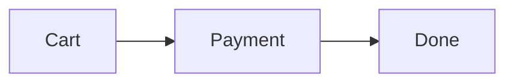

# Write diagrams

A diagram is a ` ```mermaid ` code block with Mermaid syntax. Pele supports
every diagram type built into Mermaid 12.1. The [Gallery](../examples/index.md)
has all 32 types that Pele renders, each next to its Markdown.

````markdown

````


Diagrams work inside content tabs, admonitions and lists, like any other code
block.

## When a diagram doesn't render

Each diagram element has a `data-pele-state` attribute. Inspect the element in
the browser to read it:

| Value     | Meaning                                                  |
| --------- | -------------------------------------------------------- |
| `loading` | The browser is downloading Pele.                         |
| `mounted` | Pele drew the diagram, or an error message in its place. |
| `failed`  | Pele didn't load, or threw an error. The source stays.   |

A diagram with a syntax error is `mounted`: Pele writes the error inside the
diagram element, where you'd expect the drawing. Fix the source and reload.

A `failed` diagram usually means the browser couldn't download Pele. The
browser console has the error, with a `[zensical-pele]` prefix. Check that the
page can reach jsDelivr, or the URL you set in
[`module_url`](../setup/loading-pele.md#module_url).

When the source shows as plain text and the element has no `data-pele-state`
at all, the page's script didn't run. Check that JavaScript is enabled and that
the block is a ` ```mermaid ` block, or a language in
[`fences`](../setup/fences.md#fences).
