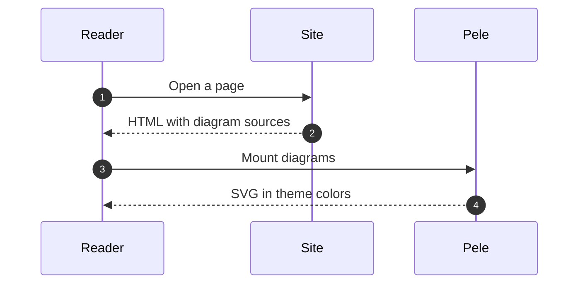

# Get started

zensical-pele is a Python package with a Markdown extension named `pele`.
Install it where your site is built, enable the extension, and your existing
` ```mermaid ` blocks render with Pele.

## Requirements

- Python 3.11 or later.
- Zensical, or MkDocs with
  [`pymdownx.superfences`](https://facelessuser.github.io/pymdown-extensions/extensions/superfences/).
- JavaScript in the reader's browser. Without it, readers see the diagram
  source.

## Install

Add the package to the environment that builds your site:

=== "uv"

    ```sh
    uv add zensical-pele
    ```

=== "pip"

    ```sh
    pip install zensical-pele
    ```

=== "uvx"

    If you run Zensical as a tool, add the package to the tool's environment:

    ```sh
    uvx --with zensical-pele zensical build
    ```

## Enable the extension

Add `pele` to your Markdown extensions:

=== "zensical.toml"

    ```toml
    [project.markdown_extensions.pymdownx.superfences]

    [project.markdown_extensions.pele]
    ```

=== "mkdocs.yml"

    ```yaml
    markdown_extensions:
      - pymdownx.superfences
      - pele
    ```

Zensical enables `pymdownx.superfences` by default. If your configuration lists
the Markdown extensions, keep `pymdownx.superfences` in the list.

`pele` is the name the package registers with Python Markdown. The Python
module is `zensical_pele`, which also works as the extension name.

## Write a diagram

Write a regular Mermaid code block:

````markdown

````

The block renders like this:


Serve the site with `uv run zensical serve` and open a page with a diagram. If
the source shows instead of the drawing, see
[When a diagram doesn't render](../authoring/diagrams.md#when-a-diagram-doesnt-render).

## Next steps

- [Migrate from Mermaid.js](migrate.md) if your site already has diagrams.
- [Load Pele](../setup/loading-pele.md) to pin the Pele version before you
  publish.
- [Gallery](../examples/index.md) for every diagram type you can write.
