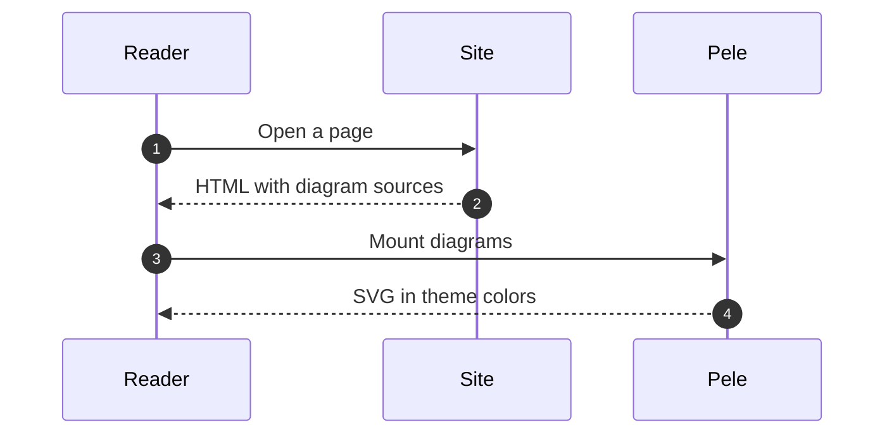

# Getting started

## Requirements

- Python 3.11 or later.
- Zensical, or MkDocs with
  [`pymdownx.superfences`](https://facelessuser.github.io/pymdown-extensions/extensions/superfences/).
- JavaScript in the reader's browser. Without it, readers see the diagram
  source.

## Install

Add the package to the environment that builds your site:

=== "uv"

    ```sh
    uv add zensical-pele
    ```

=== "pip"

    ```sh
    pip install zensical-pele
    ```

=== "uvx"

    If you run Zensical as a tool, add the package to the tool's environment:

    ```sh
    uvx --with zensical-pele zensical build
    ```

## Enable the extension

zensical-pele is a Python Markdown extension, so it goes with your other
Markdown extensions:

=== "zensical.toml"

    ```toml
    [project.markdown_extensions.pymdownx.superfences]

    [project.markdown_extensions.zensical_pele]
    ```

=== "mkdocs.yml"

    ```yaml
    markdown_extensions:
      - pymdownx.superfences
      - zensical_pele
    ```

Zensical enables `pymdownx.superfences` by default. If your configuration lists
the Markdown extensions, keep `pymdownx.superfences` in the list.

A `mermaid` entry in `custom_fences` can stay where it is, because
zensical-pele takes precedence over it. You can remove it after migrating.

## Write a diagram

Write a regular Mermaid code block:

````markdown

````

The block renders like this:


## Check the result

Serve the site and open a page with a diagram:

```sh
uv run zensical serve
```

Each diagram element has a `data-pele-state` attribute:

| Value     | Meaning                                                    |
| --------- | ---------------------------------------------------------- |
| `loading` | The browser is downloading Pele.                           |
| `mounted` | Pele drew the diagram, or an error message in its place.   |
| `failed`  | Pele didn't load, or threw an error. The source stays.     |

Pele shows syntax errors inside the diagram element, so a diagram with a typo
is `mounted` and shows the error. Other errors appear in the browser console
with a `[zensical-pele]` prefix.

Next, [Configuration](configuration.md) shows how to pin the Pele version
before you publish.
