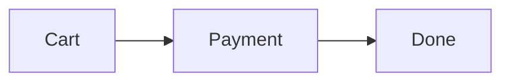
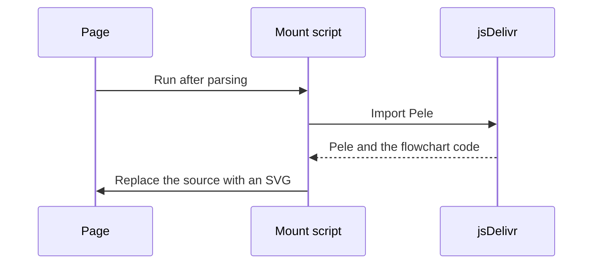
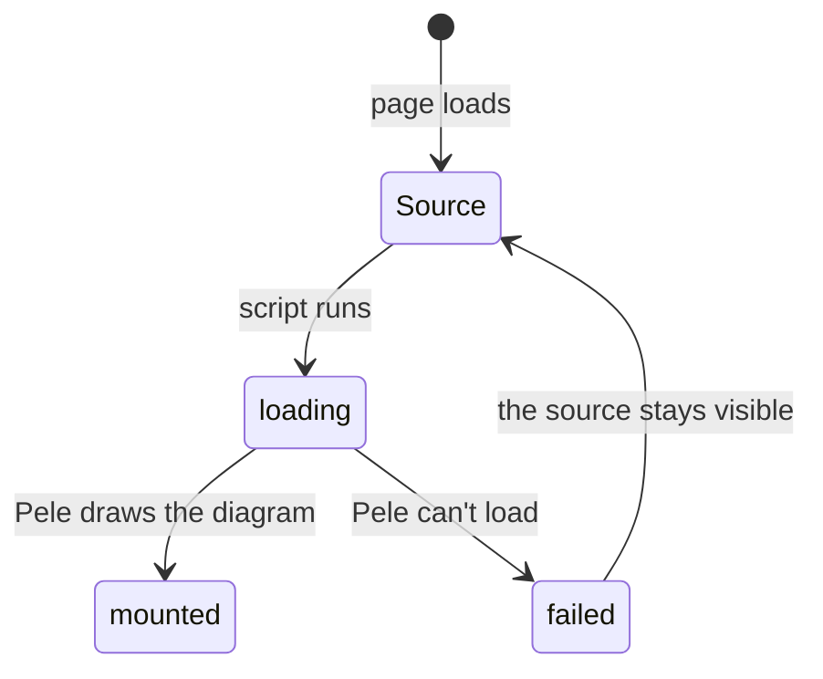

# How it works

Zensical has no plugin API yet, but it runs Python Markdown extensions, and
zensical-pele is one. The extension does two things at build time: it turns
each Mermaid block into an element that holds the diagram source, and it adds
a script to the pages that have one. The script draws the diagrams in the
browser.

Follow one diagram through both steps. Take this block from a page:

````markdown

````

## At build time, the block becomes a placeholder

Zensical hands the page to Python Markdown. SuperFences, the extension that
handles code blocks, has a list of custom fences. Before the first page is
converted, zensical-pele adds a `mermaid` fence to the end of that list.
SuperFences checks the list from the end, so this fence wins over the
`mermaid` fence that Zensical configures by default.

The fence writes the source into a `<div>`, escaped like any other text:

```html
<div class="pele-diagram" data-pele-diagram>flowchart LR
  Cart --&gt; Payment --&gt; Done</div>
```

Once the whole page is converted, zensical-pele looks for the
`data-pele-diagram` attribute. If it finds one, it appends a `<style>` element
and a `<script type="module">` to the page. A page without diagrams gets
neither.

## In the browser, the script draws the diagram



The script imports Pele's lazy entry point from jsDelivr, or from
`module_url` when it is set. The lazy entry point downloads the code for the
diagram types on the page and skips the others, so the checkout page above
never downloads the code for Gantt charts or mind maps.

For each element, the script reads the source, clears the element and calls
Pele's `mountAsync()`. Pele measures the element's width, draws the SVG, and
draws it again when the width changes. The element's `data-pele-state` moves
through these states:



## Instant navigation runs the script again

With instant navigation, Zensical swaps the page content instead of loading a
new page, and runs the scripts in the new content. The mount script runs on
every page it is part of. It keeps the list of mounted diagrams on
`globalThis`, releases the diagrams of the page that is gone and mounts the
new ones. The browser downloads Pele once, because it caches the module after
the first import.

## What this design costs

- Readers need JavaScript. Without it, they see the diagram source as text.
- Pele lays out diagrams its own way, so they look different from Mermaid.js.
  The [Pele compatibility notes](https://pele.run/compatibility) list the
  differences.
- By default, the browser loads Pele from jsDelivr. Set `module_url` to host
  Pele with your site; [Configuration](configuration.md#module_url) shows how.
- zensical-pele depends on Zensical converting pages with Python Markdown.
  Zensical plans a Module API for Python; once it ships, the extension can
  become a module.
