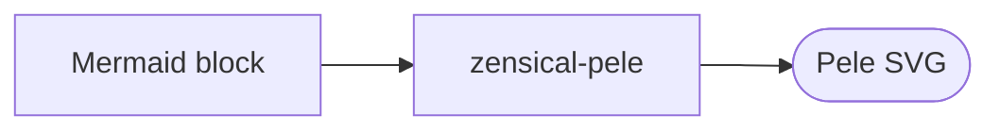

# zensical-pele

zensical-pele is a Markdown extension that renders the Mermaid diagrams of a
[Zensical](https://zensical.org) or MkDocs site with [Pele](https://pele.run)
instead of Mermaid.js.

## How it works

Write a `mermaid` code block, as you would for Mermaid.js:

````markdown

````

Pele draws it in the browser, in the colors and fonts of your theme:



Switch the color scheme in the header. The diagram changes colors without being
drawn again.

## Why Pele?

Pele supports every diagram type built into Mermaid 12.1. The
[Pele site](https://pele.run) compares it with Mermaid.js:

|                    | Pele              | Mermaid.js          |
| ------------------ | ----------------- | ------------------- |
| Bundle size (gzip) | 230 kB            | 1.6 MB              |
| Render time        | 0.05 to 0.3 ms    | 6 to 82 ms          |
| Dependencies       | 0                 | 23                  |
| Small screens      | Adapts the layout | Scales the diagram  |
| Theming            | CSS variables     | Theme configuration |

## Install

zensical-pele needs Python 3.11 or later. Add it to the environment that builds
your site:

```sh
uv add zensical-pele
```

Then enable the extension:

=== "zensical.toml"

    ```toml
    [project.markdown_extensions.pele]
    ```

=== "mkdocs.yml"

    ```yaml
    markdown_extensions:
      - pymdownx.superfences
      - pele
    ```

The extension works with
[`pymdownx.superfences`](https://facelessuser.github.io/pymdown-extensions/extensions/superfences/),
which Zensical enables by default. If your configuration lists the Markdown
extensions, keep it in the list.

To try it on a site without installing anything, run Zensical with the package:

```sh
uvx --with zensical-pele zensical serve
```

## Explore

- [Examples](examples/index.md): every diagram type, with its Markdown.
- [Configuration](configuration.md): pin the Pele version, host Pele yourself,
  choose the code blocks it renders.
- [Theming](theming.md): change colors and fonts, style one diagram.
- [Migrating from Mermaid.js](migrating.md): what changes on a site that
  already has diagrams.
- [Internals](internals.md): what the extension does, and what to check when a
  diagram doesn't render.

zensical-pele is open source under the MIT license, on
[GitHub](https://github.com/felipeadeildo/zensical-pele).
