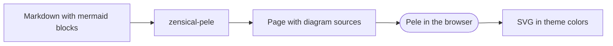

# zensical-pele

zensical-pele renders the Mermaid diagrams of a [Zensical](https://zensical.org)
site with [Pele](https://pele.run) instead of Mermaid.js. You keep writing
` ```mermaid ` blocks, and readers get diagrams in your theme colors that adapt
to small screens.



Pele drew the diagram above, and every other diagram on this site. Switch the
color scheme in the header: the diagram changes colors without being drawn
again.

## Try it on your site

If you build your site with Zensical, run it once with the extension, without
changing your project:

```sh
uvx --with zensical-pele zensical serve
```

Then enable it in `zensical.toml`:

```toml
[project.markdown_extensions.zensical_pele]
```

[Getting started](getting-started.md) covers installation, MkDocs and how to
check that diagrams render.

## Why Pele

Pele is a Mermaid renderer that the [Obsidian](https://obsidian.md) team wrote
to draw diagrams quickly in the colors of the app's theme. It reads Mermaid
syntax and supports every diagram type built into Mermaid 12.1. The Pele site
compares it with Mermaid.js:

|                    | Pele              | Mermaid.js          |
| ------------------ | ----------------- | ------------------- |
| Bundle size (gzip) | 230 kB            | 1.6 MB              |
| Render time        | 0.05 to 0.3 ms    | 6 to 82 ms          |
| Dependencies       | 0                 | 23                  |
| Small screens      | Adapts the layout | Scales the diagram  |
| Theming            | CSS variables     | Theme configuration |

The CSS variables are what make the theme work. zensical-pele points Pele's
color and font variables at the variables of the Zensical theme, so a diagram
in dark mode uses the dark palette with no extra configuration. The
[Theming](theming.md) page lists the mapping and how to change it.

Small screens get a different layout, not a smaller picture. Below 640 pixels,
Pele can turn a wide left-to-right flowchart into a top-to-bottom one, and
readers can zoom and pan a diagram that still doesn't fit.

## What to read next

- [Getting started](getting-started.md): install the extension and render a
  first diagram.
- [Configuration](configuration.md): pin the Pele version, host Pele yourself,
  pass options to Pele.
- [Gallery](examples/index.md): every diagram type, with the Markdown that
  produced it.
- [How it works](how-it-works.md): what happens at build time and in the
  browser.
