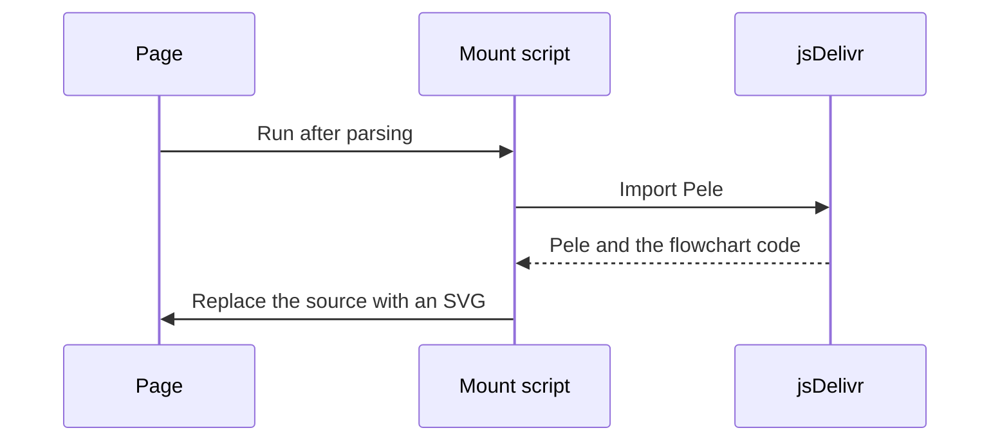

# Internals

Zensical has no plugin API yet, but it runs Python Markdown extensions, and
zensical-pele is one. At build time it turns each Mermaid block into an
element that holds the diagram source. In the browser, a script replaces that
element's content with Pele's SVG.

## Build

SuperFences, the extension that handles code blocks, keeps a list of custom
fences and checks it from the end. zensical-pele adds a `mermaid` fence to the
end of that list, so it takes precedence over the one Zensical configures.

The fence writes the source as a code block inside a `<div>`:

```html
<div class="pele-diagram" data-pele-diagram><pre><code class="language-mermaid">flowchart LR
  Cart --&gt; Payment --&gt; Done</code></pre></div>
```

Readers without JavaScript see this code block, and the Zensical `llmstxt`
plugin writes it as a `mermaid` code block in `llms.txt`. Zensical loads
Mermaid.js only for `pre.mermaid` elements, so this markup doesn't load it.

When a page has a diagram, the extension appends a `<style>` element and a
`<script type="module">` to it. A page without diagrams gets neither.

## Browser



The script imports Pele's lazy entry point from jsDelivr, or from
[`module_url`](configuration.md#module_url). The lazy entry point downloads
code only for the diagram types on the page.

For each element, the script reads the source, clears the element and calls
Pele's `mountAsync()`. Pele draws the SVG at the element's width and draws it
again when the width changes.

With instant navigation, Zensical swaps the page content and runs its scripts
again. The script releases the diagrams of the previous page and mounts the
new ones. The browser downloads Pele once.

## When a diagram doesn't render

Each diagram element has a `data-pele-state` attribute. Inspect the element in
the browser to read it:

| Value     | Meaning                                                  |
| --------- | -------------------------------------------------------- |
| `loading` | The browser is downloading Pele.                         |
| `mounted` | Pele drew the diagram, or an error message in its place. |
| `failed`  | Pele didn't load, or threw an error. The source stays.   |

A diagram with a syntax error is `mounted`, with Pele's error message where
the drawing would be.

A `failed` diagram usually means the browser couldn't download Pele. The
browser console has the error, prefixed with `[zensical-pele]`. Check that the
page can reach jsDelivr, or the URL in `module_url`.

When the element has no `data-pele-state` at all, the script didn't run. Check
that JavaScript is enabled and that the block's language is `mermaid`, or one
listed in [`fences`](configuration.md#fences).

## Limits

- Readers need JavaScript to see diagrams.
- Diagrams look different from Mermaid.js; see
  [Migrating from Mermaid.js](migrating.md#layout).
- The extension depends on Zensical converting pages with Python Markdown.
  Once Zensical ships its Module API for Python, the extension can become a
  module.
