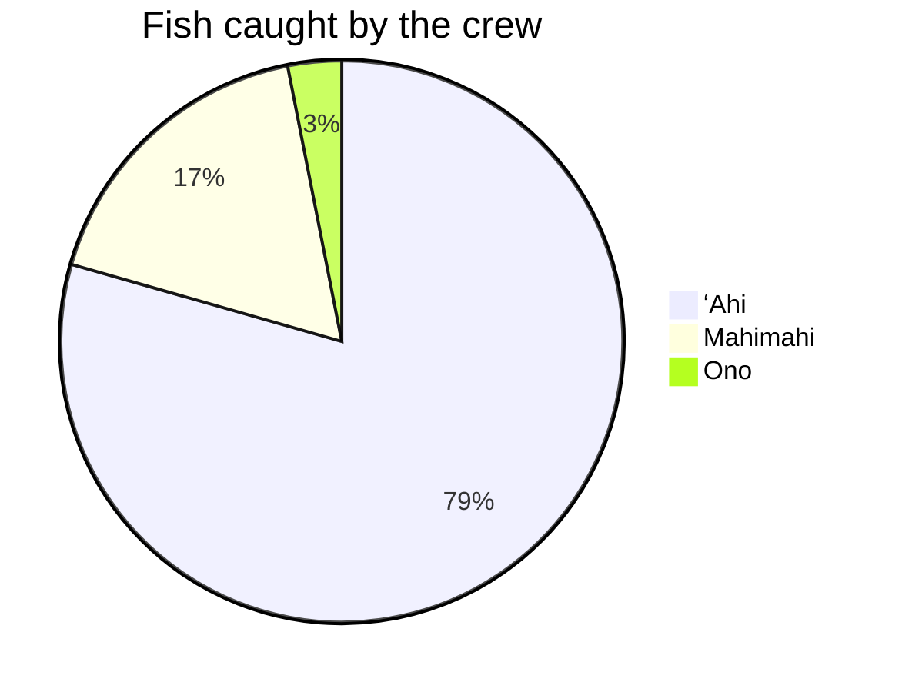

# llms.txt

The Zensical `llmstxt` plugin publishes an `llms.txt` index and a Markdown copy
of each page, for coding agents and other tools that read docs. Diagrams need
one extra step: without it, each diagram becomes a single line of text in the
Markdown copy.

```text
pie title Fish caught by the crew "ʻAhi" : 386 "Mahimahi" : 85 "Ono" : 15
```

zensical-pele has a `preprocess` hook for the plugin that turns each diagram
back into a code block:

````markdown

````

## Set it up

1. Enable the plugin. It needs `site_url` and a list of sections, with page
   paths or glob patterns relative to `docs`:

    ```toml
    [project]
    site_url = "https://example.com/"

    [project.plugins.llmstxt]
    full_output = "llms-full.txt"

    [project.plugins.llmstxt.sections]
    "Guides" = ["index.md", "guides/*.md"]
    ```

2. Create `llmstxt.py` next to `zensical.toml`, with the hook from
   zensical-pele:

    ```python
    from zensical_pele.llmstxt import preprocess

    __all__ = ["preprocess"]
    ```

3. Point the plugin at the script:

    ```toml
    [project.plugins.llmstxt]
    full_output = "llms-full.txt"
    preprocess = "llmstxt.py"
    ```

4. Build the site. Open the Markdown copy of a page with a diagram, for
   example `site/guides/index.md`, and check that the diagram is a
   ` ```mermaid ` block.

To do more in the same hook, call zensical-pele's function from your own:

```python
from zensical_pele.llmstxt import preprocess as restore_diagrams


def preprocess(html: str, output: str) -> str:
    html = restore_diagrams(html, output)
    return html.replace("Internal only", "")
```

## What agents get

- `llms.txt` lists the pages of each section, with links to their Markdown
  copies.
- `llms-full.txt` has the text of every listed page in one file, when
  `full_output` is set.
- With `content.action.copy` in the theme features, each page gets a button
  that copies its Markdown.

Diagrams always come out as ` ```mermaid ` blocks, even when
[`fences`](fences.md#fences) renders another language, because Pele reads
Mermaid syntax.

The hook works with the Zensical plugin only. The MkDocs `mkdocs-llmstxt`
plugin passes a BeautifulSoup object to its hook, not a string.

This site uses the hook: see its [llms.txt](https://felipeadeildo.github.io/zensical-pele/llms.txt).
