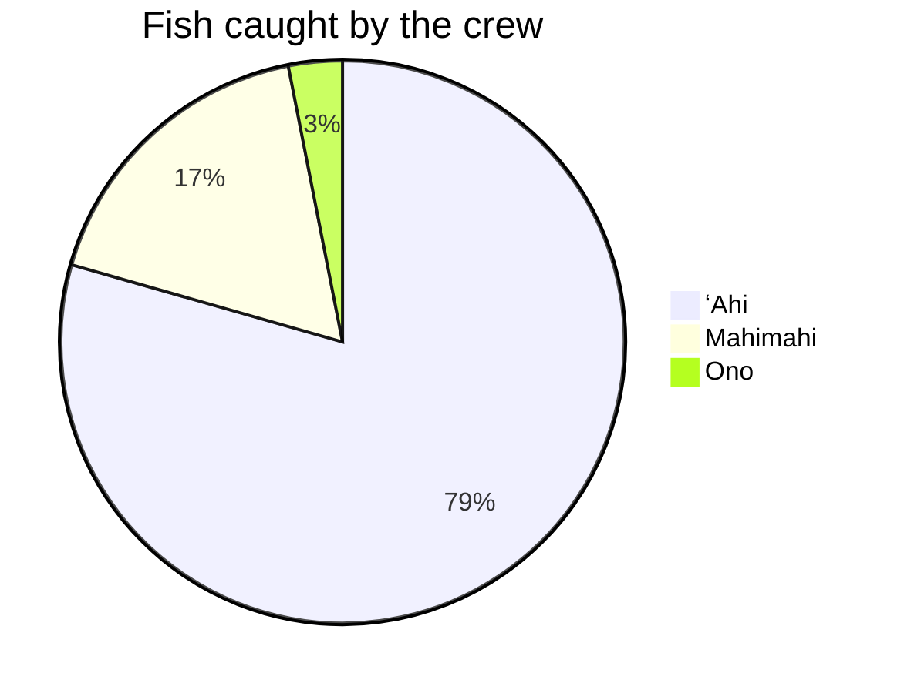

# llms.txt

The Zensical `llmstxt` plugin publishes an `llms.txt` index and a Markdown copy
of each page, for coding agents and other tools that read docs. Diagrams come
out as ` ```mermaid ` code blocks with no extra setup, because the extension
writes each diagram's source as a `mermaid` code block in the page's HTML:

````markdown

````

## Set it up

1. Enable the plugin. It needs `site_url` and a list of sections, with page
   paths or glob patterns relative to `docs`:

    ```toml
    [project]
    site_url = "https://example.com/"

    [project.plugins.llmstxt]
    full_output = "llms-full.txt"

    [project.plugins.llmstxt.sections]
    "Guides" = ["index.md", "guides/*.md"]
    ```

2. Build the site. Open the Markdown copy of a page with a diagram, for
   example `site/guides/index.md`, and check that the diagram is a
   ` ```mermaid ` block.

## What agents get

- `llms.txt` lists the pages of each section, with links to their Markdown
  copies.
- `llms-full.txt` has the text of every listed page in one file, when
  `full_output` is set.
- With `content.action.copy` in the theme features, each page gets a button
  that copies its Markdown.

Diagrams always come out as ` ```mermaid ` blocks, even when
[`fences`](fences.md#fences) renders another language, because Pele reads
Mermaid syntax.

This site publishes its own: see its
[llms.txt](https://felipeadeildo.github.io/zensical-pele/llms.txt).
